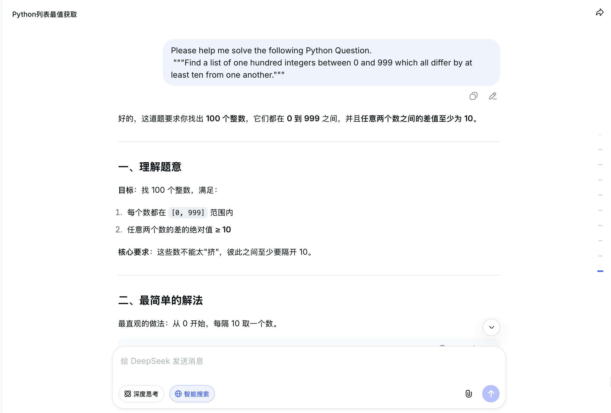
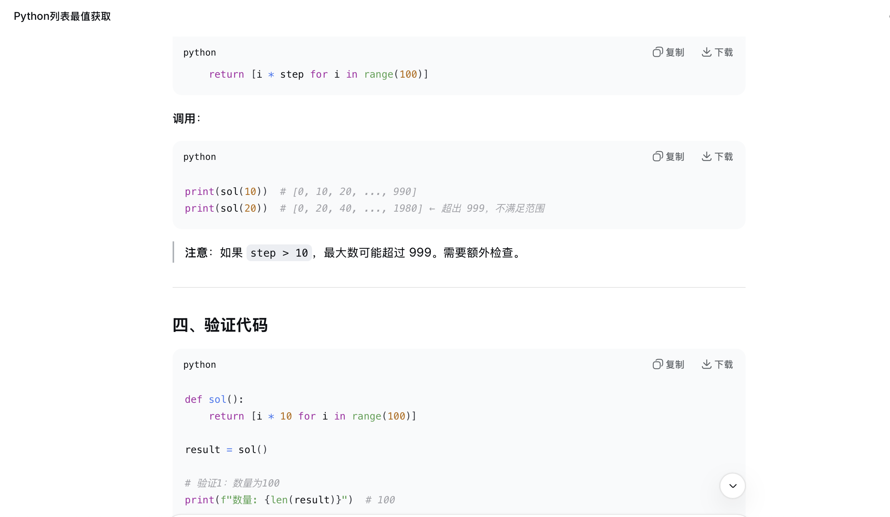
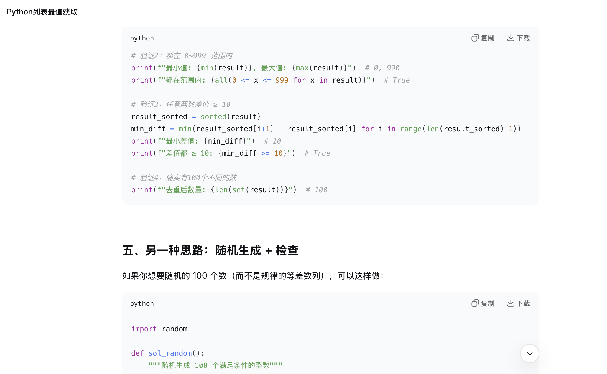
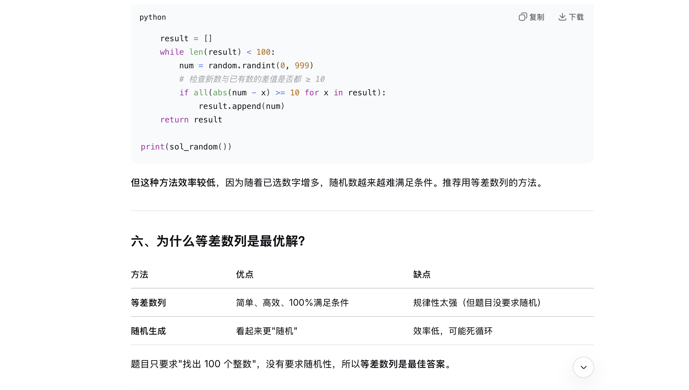
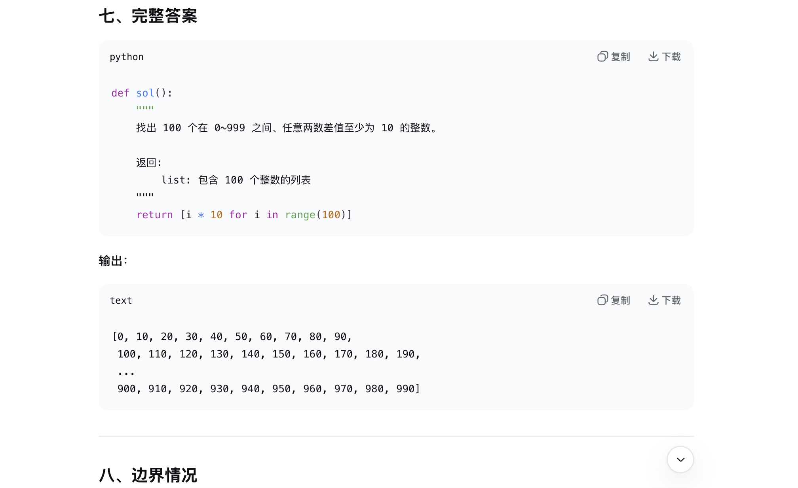
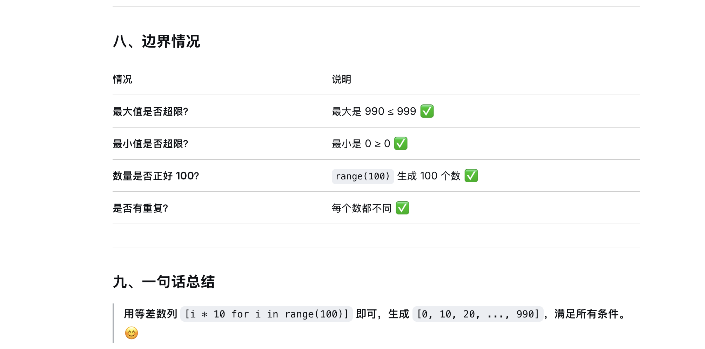

# Problem 1

## Your prompt to generate solution

```plain
# your AI model here
    DeepSeek

# your prompt here
    Please help me solve the following Python Question."""Find a list of one hundred integers between 0 and 999 which all differ by at least ten from one another."""
```

## Initial AI-generated solution

```python
# AI-generated solution here
def sol():
    """找出 100 个在 0~999 之间、任意两数差值至少为 10 的整数"""
    return [i * 10 for i in range(100)]
```

## (optional) Your edited solution

Note: you may skip this section if AI-generated solution is correct.

The errors found in the AI-generated solution:
1. to be filled here
2. 
3.

Your edited solution:

```python
# your solution after debugging here
```

## Screenshots of interaction with AI

Please capture the screenshot and paste it here.






