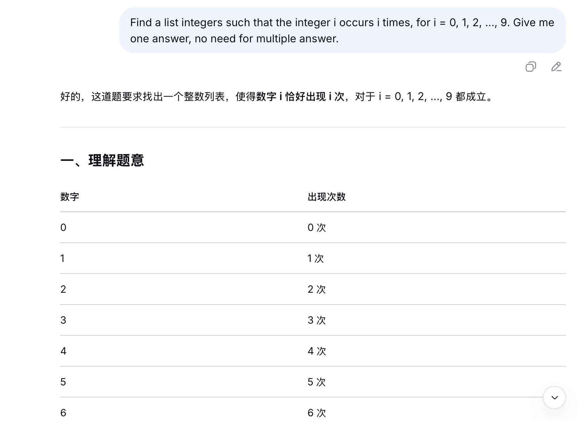
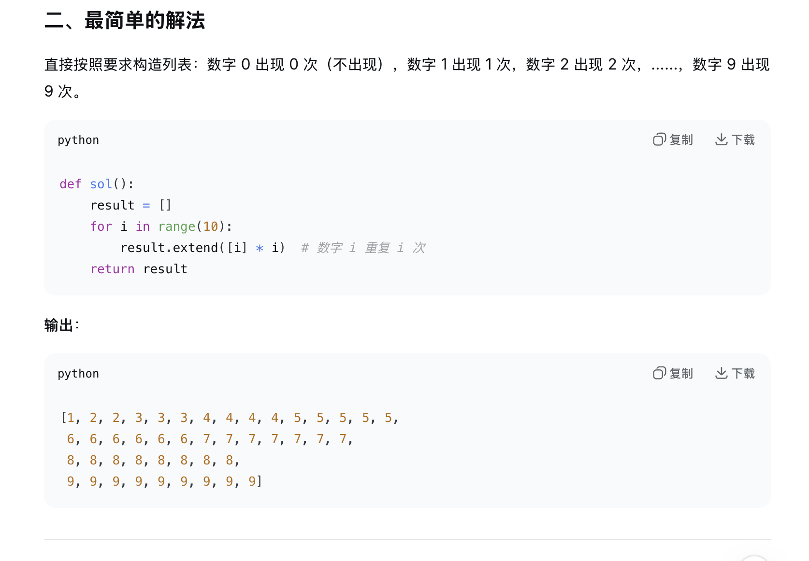
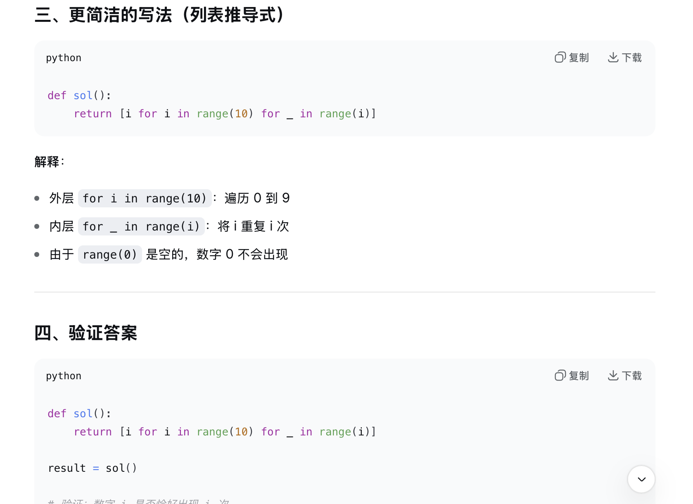
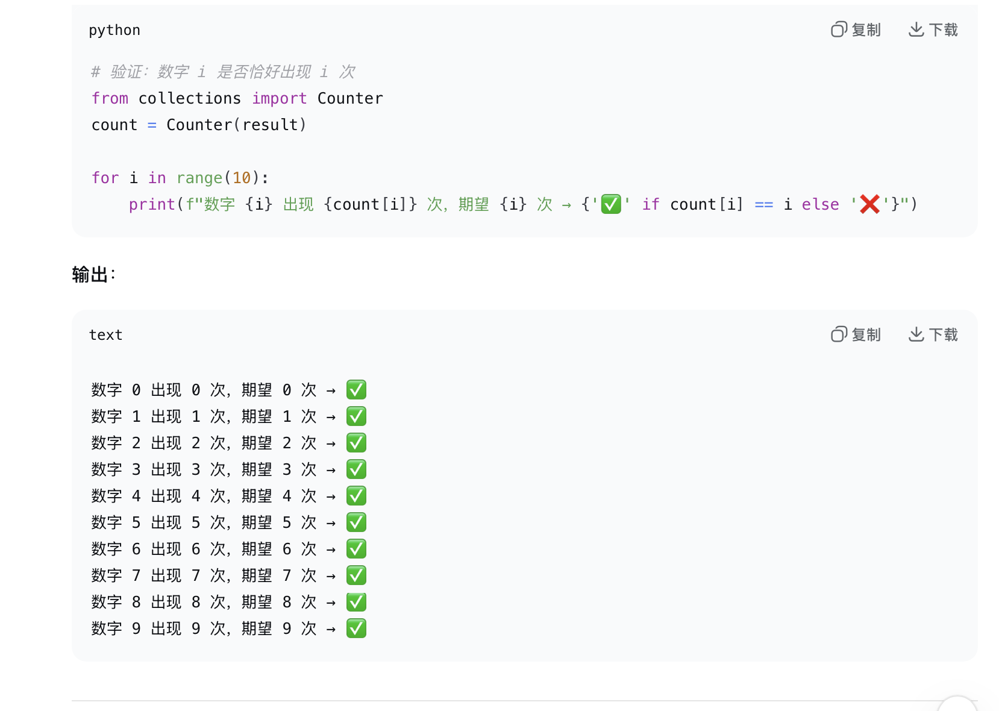
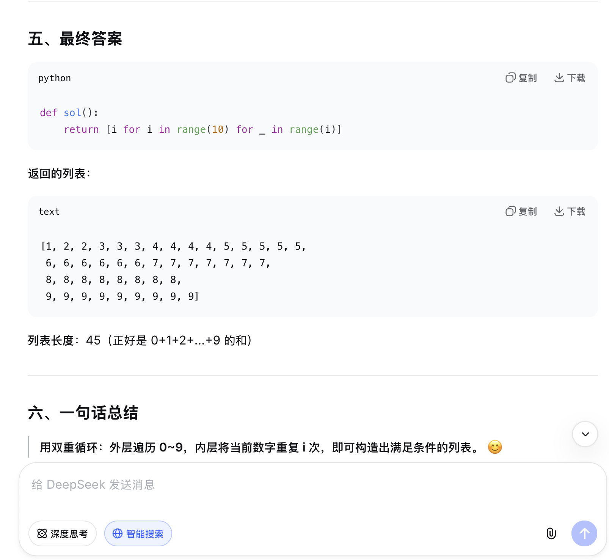

# Problem 2

## Your prompt to generate solution

```plain
# your AI model here
    DeepSeek
# your prompt here
    Find a list integers such that the integer i occurs i times, for i = 0, 1, 2, ..., 9. Give me one answer, no need for multiple answer.
```

## Initial AI-generated solution

```python
# AI-generated solution here
def sol():
    result = []
    for i in range(10):
        result.extend([i] * i)  # 数字 i 重复 i 次
    return result
#利用列表推导式更简洁的写法
def sol():
    return [i for i in range(10) for _ in range(i)]
```

## (optional) Your edited solution

Note: you may skip this section if AI-generated solution is correct.

The errors found in the AI-generated solution:
1. to be filled here
2. 
3.

Your edited solution:

```python
# your solution after debugging here
```

## Screenshots of interaction with AI

Please capture the screenshot and paste it here.




