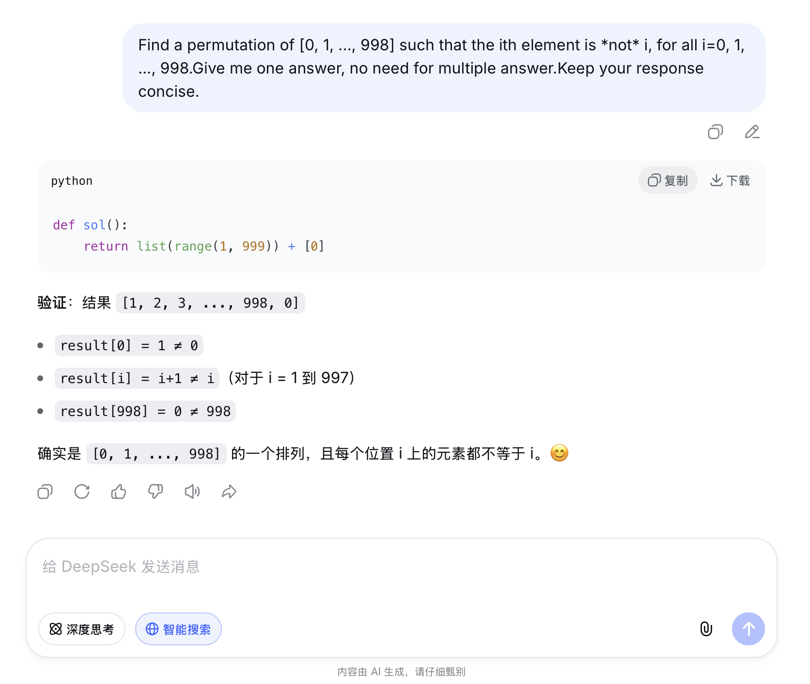

# Problem 3

## Your prompt to generate solution

```plain
# your AI model here
    DeepSeek
# your prompt here
    Find a permutation of [0, 1, ..., 998] such that the ith element is *not* i, for all i=0, 1, ..., 998.Give me one answer, no need for multiple answer.Keep your response concise.
```

## Initial AI-generated solution

```python
# AI-generated solution here
def sol():
    return list(range(1, 999)) + [0]
```

## (optional) Your edited solution

Note: you may skip this section if AI-generated solution is correct.

The errors found in the AI-generated solution:
1. to be filled here
2. 
3.

Your edited solution:

```python
# your solution after debugging here
```

## Screenshots of interaction with AI

Please capture the screenshot and paste it here.
