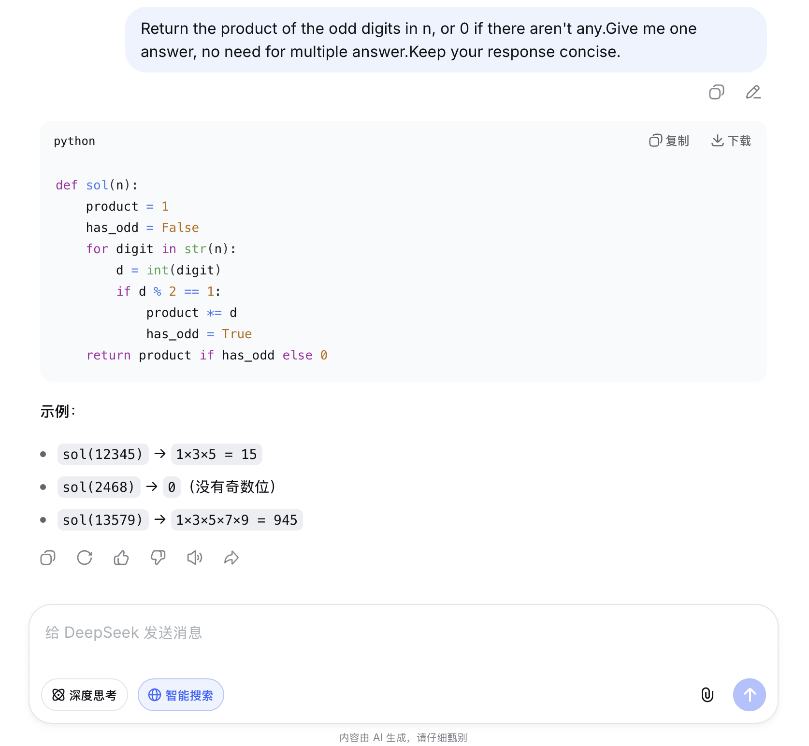

# Problem 4

## Your prompt to generate solution

```plain
# your AI model here
    DeepSeek
# your prompt here
    Return the product of the odd digits in n, or 0 if there aren't any.Give me one answer, no need for multiple answer.Keep your response concise.
```

## Initial AI-generated solution

```python
# AI-generated solution here
def sol(n):
    product = 1
    has_odd = False
    for digit in str(n):
        d = int(digit)
        if d % 2 == 1:
            product *= d
            has_odd = True
    return product if has_odd else 0
```

## (optional) Your edited solution

Note: you may skip this section if AI-generated solution is correct.

The errors found in the AI-generated solution:
1. to be filled here
2. 
3.

Your edited solution:

```python
# your solution after debugging here
```

## Screenshots of interaction with AI

Please capture the screenshot and paste it here.
